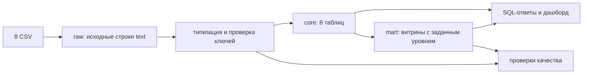

# Архитектура модели Capibara

## Назначение и границы

Проект превращает восемь исходных CSV (550 759 строк) в воспроизводимую типизированную модель PostgreSQL 16. Аналитики получают ответы из `core` и `mart`; схема `raw` остаётся точной копией выгрузок. Основа уже существующей реализации сохраняется: восемь таблиц `core`, повторно используемые витрины `mart` и отдельные SQL-запросы ответов. Текущий код — исходная точка, а не подтверждение готовности: его нужно привести к описанным ниже правилам и проверить на чистой базе.

## Согласованные решения

| Решение | Правило | Причина |
| --- | --- | --- |
| Основа модели | Сохранить и усилить текущие `core` и `mart`. | Восемь сущностей покрывают источники и позволяют отвечать на будущие вопросы без схемы под пять известных запросов. |
| Сборка | Полная повторная сборка в одной транзакции; контроль до `COMMIT`. | Текущий объём невелик, а ошибка не должна оставлять частично обновлённую модель. |
| Категории | Явная запись `Non category` для пустого значения; прочие категории показывать английскими именами в `snake_case`, сохранив португальское имя. | Каждая позиция попадает ровно в одну категорию, и выручка сверяется с общей суммой. |
| Месячные итоги | `mart.monthly_sales` охватывает все месяцы исходных данных; требуемые 24 месяца с нулевым месяцем формирует запрос ответа. | Новые периоды можно анализировать без изменения общей витрины. |
| Покупатели | Покупателя и повторную покупку считать по всем оформленным заказам независимо от статуса. | Только так воспроизводятся контрольные 96 096 покупателей и 3,12% повторных. |
| Сырые данные | Не изменять `raw`; все приведения типов выполнять в `core`. | Источник остаётся воспроизводимым и пригодным для диагностики. |

## Зерно таблиц и связи

| Таблица | Одна строка | Ключ и важные связи |
| --- | --- | --- |
| `core.customers` | запись покупателя при оформлении заказа | `customer_id`; стабильный человек — `customer_unique_id`, который может встречаться у нескольких `customer_id`. |
| `core.sellers` | продавец | `seller_id`. |
| `core.categories` | исходная португальская категория или `Non category` | отдельный технический ключ; исходное имя, английская подпись и признак происхождения перевода. |
| `core.products` | карточка товара | `product_id`; обязательная связь с категорией, включая `Non category`. |
| `core.orders` | заказ | `order_id`; ссылка на `customer_id`, статус и хронология. |
| `core.order_items` | одна единица товара одного продавца в заказе | `(order_id, order_item_id)`; ссылки на заказ, товар и продавца; цена и доставка позиции. |
| `core.order_payments` | способ/часть оплаты заказа | `(order_id, payment_sequential)`; сумма платежа не является выручкой. |
| `core.order_reviews` | отзыв о заказе | `(review_id, order_id)`; отдельный факт, не соединяемый напрямую с позициями при расчёте денег. |

Ссылки должны запрещать сиротские строки. Пустое значение допустимо только там, где оно имеет смысл в источнике; оно не должно превращаться в потерянную строку. Денежные поля — `numeric`, даты — `timestamp` без предположения о часовом поясе, почтовый префикс — `text` для сохранения ведущих нулей. Число единиц товара равно числу строк `order_items`, поскольку одна строка — одна единица.

Для 71 категории используйте английские имена из `raw.product_category_translation`. Две отсутствующие пары дополните явно: `pc_gamer → gaming_pcs` и `portateis_cozinha_e_preparadores_de_alimentos → portable_kitchen_and_food_processors`. Отсутствие категории отображайте ровно как `Non category`. У каждой категории сохраняйте исходное португальское имя и признак того, взят ли перевод из источника или добавлен вручную.

## Определения показателей и витрины

| Витрина | Зерно | Определение |
| --- | --- | --- |
| `mart.order_financials` | заказ | Предварительно агрегирует позиции по `order_id`, затем добавляет заказ и покупателя; отдельно хранит сумму цен товаров, доставку, полную стоимость и число позиций. |
| `mart.monthly_sales` | месяц с заказами в источнике | Выручка и число доставленных заказов по месяцу оформления за весь доступный период; пустые месяцы добавляет календарный ряд в запросе конкретного отчёта. |
| `mart.seller_sales` | продавец | Цена только его доставленных позиций, число единиц и `count(distinct order_id)`. |
| `mart.customer_orders` | `customer_unique_id` | Число всех оформленных заказов, даты первого и последнего оформления; выручка отдельно только по доставленным заказам. |
| `mart.category_sales` | категория | Цена доставленных позиций и доля в общей выручке; 73 исходные категории плюс `Non category`. |

**Выручка** = сумма `order_items.price` только для заказов со статусом `delivered`; доставка и платежи в неё не входят. **Средний чек** = среднее по доставленным заказам от суммы `price + freight_value` всех позиций заказа. **Повторный покупатель** = `customer_unique_id` с двумя и более оформленными заказами любого статуса. Для каждого показателя время относится к `orders.order_purchase_timestamp`, если в конкретном вопросе не задано иное.

Позиции, платежи и отзывы имеют независимые связи «один ко многим» с заказом. При совместном анализе сначала агрегируйте каждый факт до нужного зерна; прямое соединение размножает строки.

## Порядок исполнения

1. `scripts/setup.sh` поднимает PostgreSQL и загружает все восемь файлов в `raw`.
2. Сборка проверяет ключи и необходимые значения, типизирует все источники, создаёт `core` и витрины `mart` в одной транзакции.
3. До фиксации транзакции выполняются проверки количеств строк, уникальности, связей и сверки показателей. Любое расхождение вызывает ошибку и откат.
4. `model/02_answers.sql` печатает пять известных ответов из модели. Для первого вопроса запрос генерирует 24 месяца с сентября 2016 по август 2018 и присоединяет `mart.monthly_sales`, подставляя нули для отсутствующего месяца. При появлении новых вопросов дополняются запросы и проверки, а модель расширяется только при выявленной нехватке сущностей или атрибутов.
5. Результаты и команды воспроизведения фиксируются в документации сдачи.

Скрипт `model/run.sh` должен выполнять сборку и проверки одной командой `psql` с одной транзакцией. Выполнение на чистой базе и повторный запуск должны давать одинаковые результаты; намеренно внесённая ошибка должна оставлять предыдущую рабочую модель.

## Контроль качества

- Проверить количество строк во всех восьми таблицах `raw` против ожидаемого снимка, затем равенство семи основных таблиц `raw` и одноимённых таблиц `core` без потерь и размножения. Для справочника переводов проверить покрытие всех 71 пары в `core.categories`, где также должны быть две дополнительные категории и `Non category`.
- Проверить уникальность естественных ключей до вставки, отсутствие сиротских ссылок, корректность обязательных типов и отсутствие недопустимой произвольной дедупликации.
- Проверить, что каждый товар получил категорию, а сумма выручки по категориям равна общей выручке.
- Для опубликованного снимка проверить 24 строки за сентябрь 2016 — август 2018, один месяц с нулевой выручкой и итог `13 221 498.11`; топ-продавца `226 987.93`; средний чек `159.88`; `96 096` покупателей и `3,12%` повторных; 74 категории и максимальную категорию `1 233 131.72`.
- Не подменять общие инварианты контрольными числами снимка: первые должны оставаться полезными после появления новых данных, вторые выявляют регрессию на выданной выгрузке.

## Исправленные разрывы исходной реализации

В исходном SQL товары без категории выпадали из отчёта, две категории не имели английского перевода, месячная витрина была ограничена 24 месяцами, а почтовый префикс приводился к числу. Сборка и проверки выполнялись отдельно, поэтому ошибка проверки не сохраняла прежнюю модель. `setup.sh` не выбирал `py -3` в Git Bash. Эти места исправлены: после чистой установки все восемь источников загружены, сборка прошла проверки PostgreSQL, а повторный запуск и намеренная ошибка подтвердили откат. Фактические результаты и ссылки на отчёты приведены в [плане реализации](implementation-task.md). В исходном CSV остаются 610 товаров без категории и 13 товаров в двух категориях без перевода; модель сохраняет их явно.

## Развитие

При новых требованиях в первую очередь добавлять новые факты и атрибуты к общей модели, сохраняя исходное зерно. Для меняющихся карточек товара и реквизитов продавца понадобится история версий с периодом действия; исходный снимок такой истории не содержит, поэтому восстанавливать прошлые значения сейчас нельзя. На текущих ~550 тыс. строк PostgreSQL достаточно. При росте сначала упрутся полная пересборка и тяжёлые агрегаты: применять индексы, партиционирование по времени и затем инкрементальную загрузку с явными правилами изменения данных. Отдельное аналитическое хранилище рассматривать после измерения запросов и объёма, когда PostgreSQL перестанет укладываться в требования по времени обновления и ответа.

## Концепция дашборда

Выбрана область продаж. Адресат — руководитель коммерческого направления; решения — какие категории и продавцов развивать, где снижается число доставленных заказов и средний чек. Реализация дашборда входит в план как описание, без разработки интерфейса.

| Показатель | Формула и зерно | Источник | Сложение по срезам |
| --- | --- | --- | --- |
| Выручка | `sum(price)` доставленных позиций; позиция | `core.order_items` + `core.orders`, витрины продаж | Складывается по непересекающимся продавцам, категориям и месяцам. |
| Доставленные заказы | `count(distinct order_id)`; заказ | `mart.order_financials` | По месяцам складывается; по продавцам и категориям один заказ может попасть в несколько групп. |
| Средний чек | `sum(order_value) / count(order_id)` среди доставленных; заказ | `mart.order_financials` | Средние по группам нельзя складывать; общий чек надо пересчитать из суммы и количества. |
| Доля категории | выручка категории / общая выручка × 100; категория | `mart.category_sales` | Доли нельзя складывать при пересекающихся срезах или разных знаменателях. |
| Доля повторных покупателей | число `customer_unique_id` с ≥2 оформленными заказами / число покупателей с ≥1 оформленным заказом × 100; покупатель | `mart.customer_orders` | Доли по группам нельзя складывать. |

Фильтры: месяц оформления, продавец, категория и штат продавца. Для каждого экрана показывайте выбранный период и определение статуса `delivered` рядом с денежными показателями.
